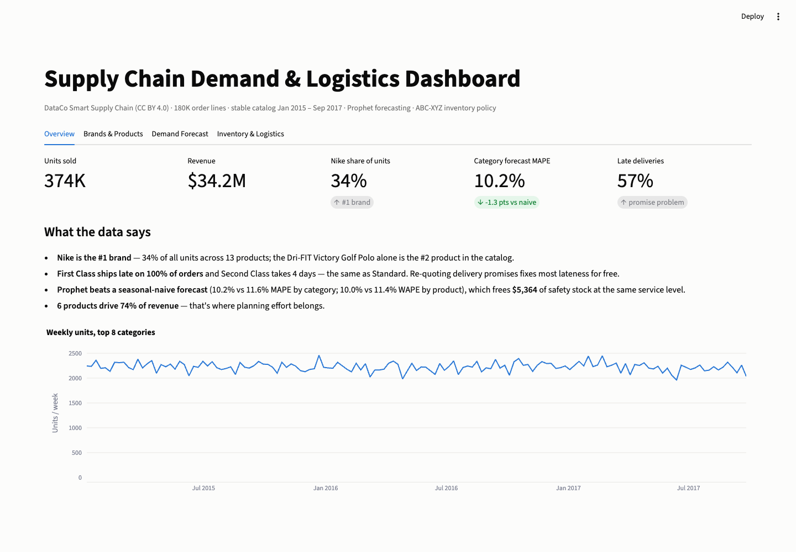
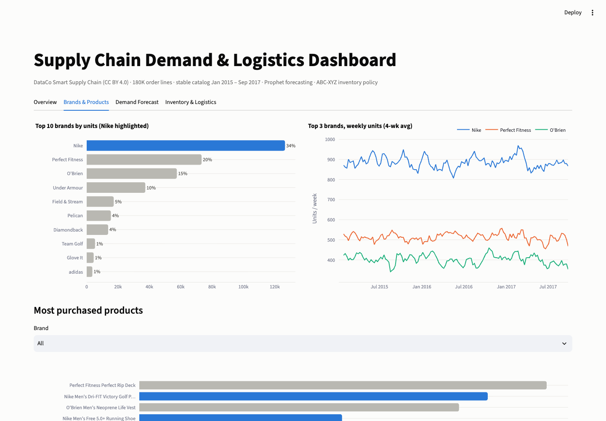
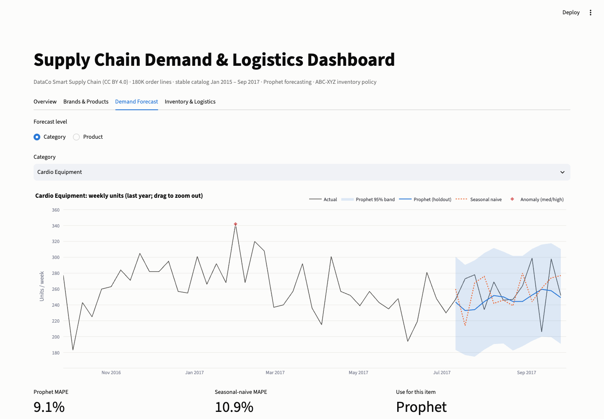
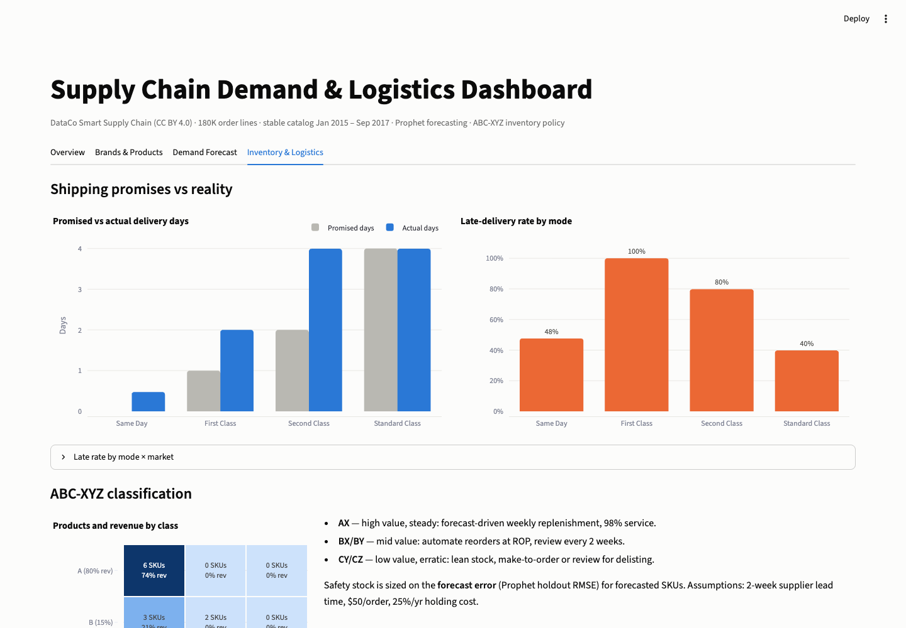

# Supply Chain Demand & Logistics Dashboard

**What sells, how much will sell next, and how should we order and ship it?**

An end-to-end Python pipeline over **180K sporting-goods & apparel order lines**
(Nike is the #1 brand at 34% of units) that ranks brands and styles, forecasts
weekly demand with Prophet against a seasonal-naive baseline, flags demand and
delivery anomalies, and turns the forecast into an **ordering policy**: ABC-XYZ
classes, safety stock, reorder points, EOQ, and a shipping-mode scorecard.
An optional module adds **real fashion style trends** from 31M H&M purchases.
Results ship in a Streamlit dashboard plus Tableau-ready extracts.



## Key findings

| | Finding | So what |
|---|---|---|
| 🚚 | **First Class is late on 100% of orders** (promised 1 day, delivers in 2). Second Class takes 4.0 days, identical to Standard. | Customers pay for speed they don't get. Re-quote First Class as 2-day, Second as 4-day (or retire it). Late rate is flat across all 5 markets, so this is a promise-setting problem, not a carrier-region problem. |
| 👟 | **Nike is the #1 brand: 34% of units** across 13 products. The Dri-FIT Victory Golf Polo is the #2 product overall. | Nike SKUs dominate class A: they get weekly forecast-driven replenishment at a 98% service level. |
| 📦 | **6 products = 74% of revenue** (class AX); 90 products split 3%/2% of revenue across erratic Y/Z classes. | Concentrate planning effort on 6 SKUs; make-to-order or review the CZ tail for delisting. |
| 📈 | **Prophet beats seasonal-naive**: 10.2% vs 11.6% MAPE by category, 10.0% vs 11.4% WAPE by product (~12% better, wins 6 of 9 products). | Sizing safety stock on Prophet's error instead of naive's frees **$5.4K** of inventory at the same service level, led by the Nike Dri-FIT polo (40 fewer units). |
| ⚠️ | **5.3% of category-weeks** breach the 95% band (2 high severity); 29 region-weeks show late-rate spikes >2σ. | Only medium/high flags are actionable; ~5% low flags are what a 95% band produces by chance. |

Full generated memo: [`outputs/recommendations.md`](outputs/recommendations.md).

## Dashboard

```bash
python run_pipeline.py          # ~5 s on DataCo; + a few minutes if H&M data is present
streamlit run app/streamlit_app.py
```

| Brands & Products | Demand Forecast | Inventory & Logistics |
|---|---|---|
|  |  |  |

Tableau Public version: build from `tableau/*.csv` with
[`docs/tableau_build_guide.md`](docs/tableau_build_guide.md).

## Pipeline

```
data/raw/DataCoSupplyChainDataset.csv
  → src/etl.py           clean, derive brand/style/segment, drop PII  → orders_clean.parquet
  → src/aggregate.py     weekly demand + fulfillment, stable window   → demand_weekly.csv
  → src/forecast.py      Prophet vs seasonal-naive, 12-wk holdout     → forecasts, metrics
  → src/products.py      brand/product ranking, SKU forecasts, outlook → product_*.csv
  → src/anomalies.py     interval-breach + late-rate spike flags      → anomalies.csv
  → src/inventory.py     ABC-XYZ, SS/ROP/EOQ, shipping scorecard      → inventory_policy.csv, recommendations.md
  → src/hm_styles.py     (optional) H&M style trends via DuckDB       → hm_*.csv
  → src/build_extract.py tidy per-view extracts                       → tableau/*.csv
  → app/streamlit_app.py dashboard (reads outputs only, no model runs)
```

## Forecast accuracy (12-week holdout, unseen by the model)

**By category (MAPE %)**

| Category | Seasonal naive | Prophet |
|---|---|---|
| Cardio Equipment | 10.9 | **9.1** |
| Cleats | **5.4** | 5.4 |
| Fishing | **11.0** | 11.1 |
| Indoor/Outdoor Games | 15.7 | **12.5** |
| Men's Footwear | **8.7** | 9.0 |
| Shop By Sport | 17.8 | **13.8** |
| Water Sports | **14.1** | 14.4 |
| Women's Apparel | 8.9 | **6.5** |
| **Mean** | 11.6 | **10.2** |

**By product (WAPE %)**. WAPE is used because MAPE is undefined on zero-sale weeks.

| Product | Seasonal naive | Prophet |
|---|---|---|
| Nike Men's Dri-FIT Victory Golf Polo | 8.7 | **6.2** |
| Nike Men's Free 5.0+ Running Shoe | 10.9 | **10.5** |
| Nike Men's CJ Elite 2 TD Football Cleat | **8.5** | 8.7 |
| Under Armour Girls' Toddler Spine Surge Running Shoe | 17.7 | **13.3** |
| O'Brien Men's Neoprene Life Vest | 15.3 | **11.9** |
| Perfect Fitness Perfect Rip Deck | **5.9** | 6.1 |
| Pelican Sunstream 100 Kayak | 14.1 | **13.2** |
| Diamondback Women's Serene Classic Comfort Bike | 10.4 | **9.3** |
| Field & Stream Sportsman 16 Gun Fire Safe | **11.1** | 11.4 |
| **Mean** | 11.4 | **10.0** |

Where naive wins, the dashboard says so and recommends keeping naive for that
item. The model is picked per SKU, not one model for the whole catalog.

## Inventory policy method

- **ABC** by cumulative revenue (80 / 15 / 5%); **XYZ** by coefficient of variation of weekly units (≤0.5 / ≤1.0 / >1.0).
- **Safety stock** `SS = z·σ·√L`, **reorder point** `ROP = d·L + SS`, **EOQ** `√(2DS/H)`; service level A 98%, B 95%, C 90%.
- σ = Prophet holdout RMSE for forecasted SKUs (safety stock buffers forecast error, not raw volatility); demand d = mean of the 12-week Prophet outlook.
- **Assumptions** (not in the data, stated so they can be challenged): 2-week supplier lead time, $50 per order, 25%/yr holding cost, unit cost = price × (1 − margin). DataCo's shipping days are customer-delivery times, so they feed the shipping scorecard, not the supplier lead time.

## Data

**DataCo Smart Supply Chain**: 180,519 order lines × 53 columns (2015–2018), **CC BY 4.0**.
Download from [Mendeley](https://data.mendeley.com/datasets/8gx2fvg2k6/5) into `data/raw/`.

> Constante, F., Silva, F., & Pereira, A. (2019). DataCo Smart Supply Chain for Big Data Analysis. Mendeley Data, V5. doi:10.17632/8gx2fvg2k6.5

**H&M Personalized Fashion Recommendations** (optional style module): ~31M
purchases, Sep 2018 – Sep 2020, from [Kaggle](https://www.kaggle.com/competitions/h-and-m-personalized-fashion-recommendations).
Requires a Kaggle account with the competition rules accepted; see
`src/hm_styles.py` for download commands. Only aggregates are produced; raw H&M
data is never committed or redistributed.

**Honest notes**
- Brands like Nike don't publish transaction data. Brand analysis here uses the
  real brand names in DataCo's (public, CC BY) product catalog, not Nike's own sales.
- DataCo's catalog changes over completely in Oct 2017; analysis uses the stable
  regime Jan 2015 – Sep 2017 (143 weeks). See [`DATA_NOTES.md`](DATA_NOTES.md).
- Anomaly flags are **in-sample** interval breaches (they mark unusual weeks, not
  forecast failures); forecast accuracy is reported on the out-of-sample holdout.
- No customer PII leaves the ETL stage; `data/` and `.env` are gitignored.

## Setup

```bash
python3 -m venv .venv && source .venv/bin/activate
pip install -r requirements.txt
python run_pipeline.py && streamlit run app/streamlit_app.py
```
